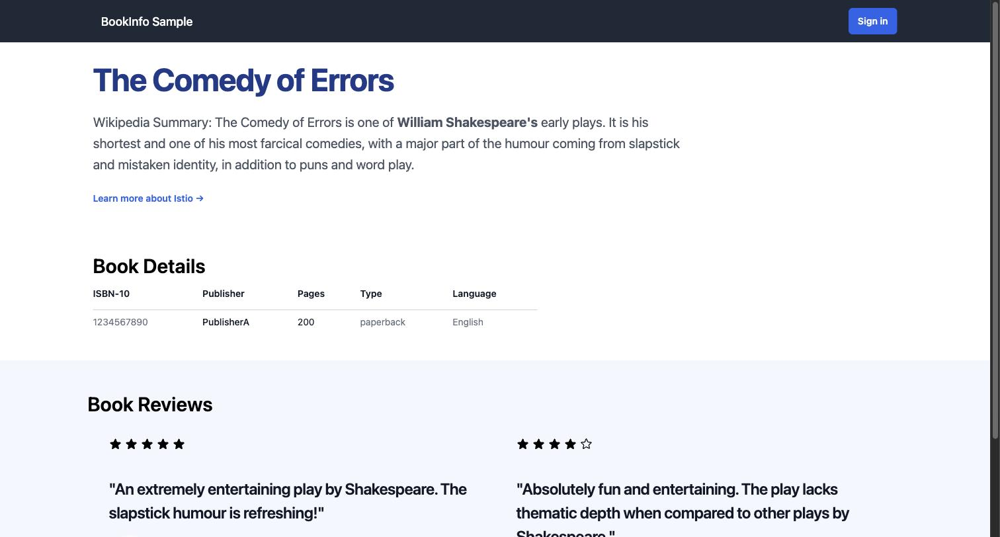
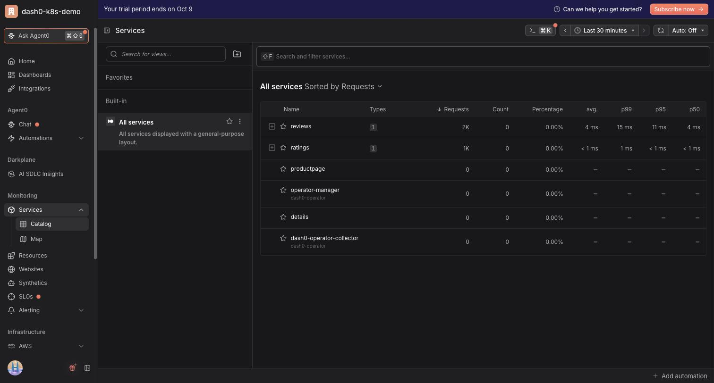
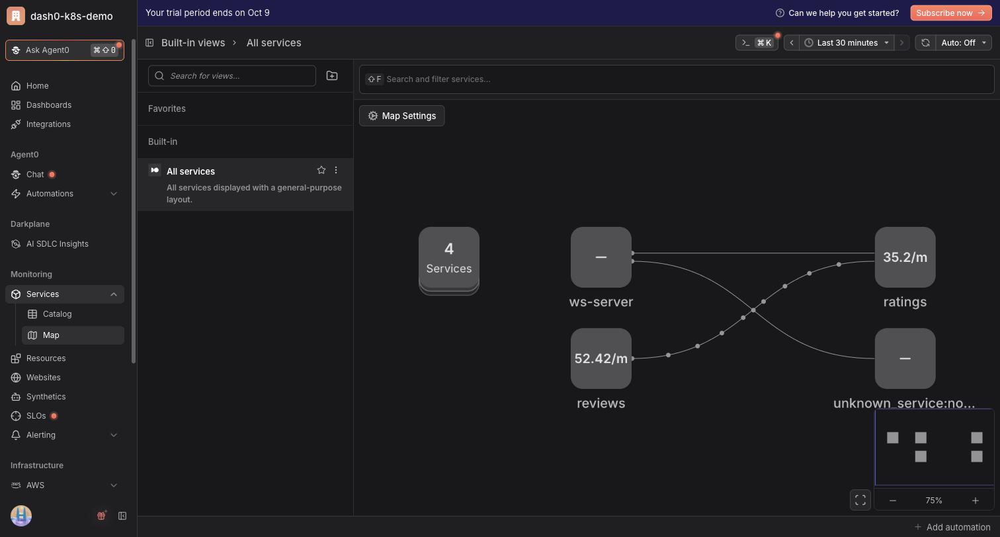
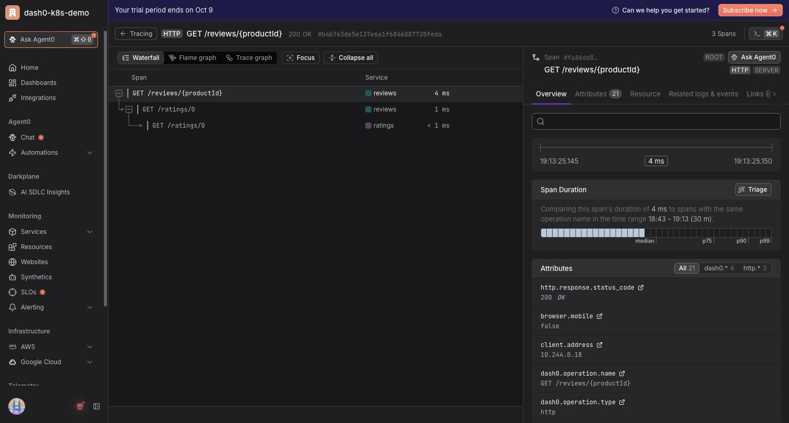
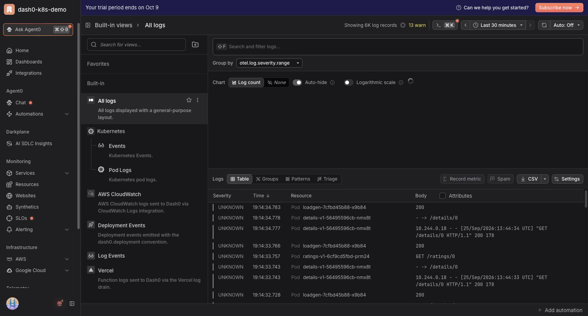
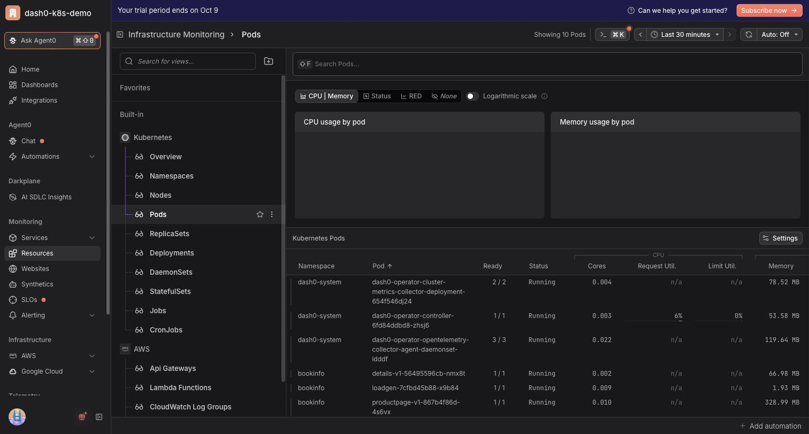

# Zero to Full-Stack Observability on Kubernetes in 20 Minutes

Dash0 operator + Istio Bookinfo (Python, Ruby, Java, Node.js) on kind.

**Needs:** Docker, `kind`, `kubectl`, `helm`, [Dash0](https://app.dash0.com) account.

## 0. Setup

```bash
cp .env.example .env   # fill from Dash0 → Endpoints + Auth Tokens
set -a; source .env; set +a
```

## 1. Cluster

```bash
kind create cluster --name dash0-demo
```

## 2. Deploy app

```bash
kubectl apply -k app/
kubectl -n bookinfo wait --for=condition=available deploy --all --timeout=5m
kubectl -n bookinfo port-forward svc/productpage 9080:9080   # localhost:9080/productpage
```



## 3. Install operator

```bash
helm repo add dash0-operator https://dash0hq.github.io/dash0-operator && helm repo update dash0-operator
helm install --wait --namespace dash0-system --create-namespace \
  --set operator.dash0Export.enabled=true \
  --set operator.dash0Export.endpoint=$DASH0_ENDPOINT \
  --set operator.dash0Export.apiEndpoint=$DASH0_API_ENDPOINT \
  --set operator.dash0Export.token=$DASH0_AUTH_TOKEN \
  --set operator.clusterName=dash0-demo \
  --set operator.instrumentation.enablePythonAutoInstrumentation=true \
  --set operator.instrumentation.enableRubyAutoInstrumentation=true \
  dash0-operator dash0-operator/dash0-operator
```

## 4. Enable monitoring

```bash
kubectl apply -n bookinfo -f dash0/dash0-monitoring.yaml
kubectl -n bookinfo get pods -w
```

## 5. Dash0

**Services → Catalog**


**Services → Map**


**Tracing**


**Logging**


**Resources → Pods**


## 6. Teardown

```bash
kind delete cluster --name dash0-demo
```
