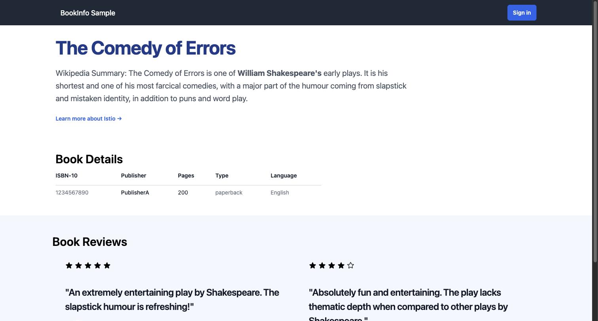
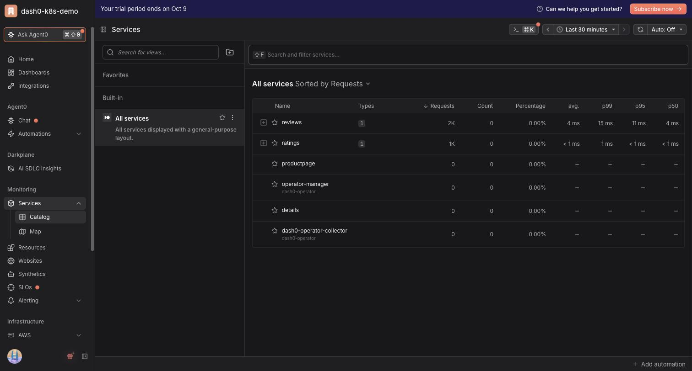
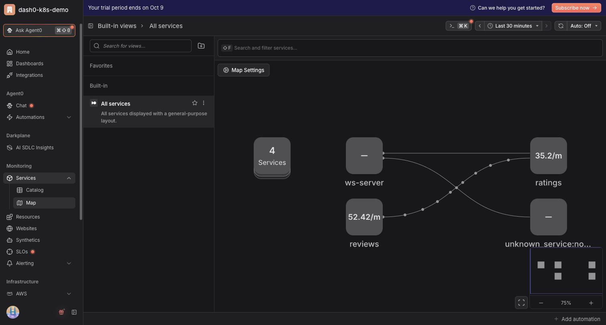
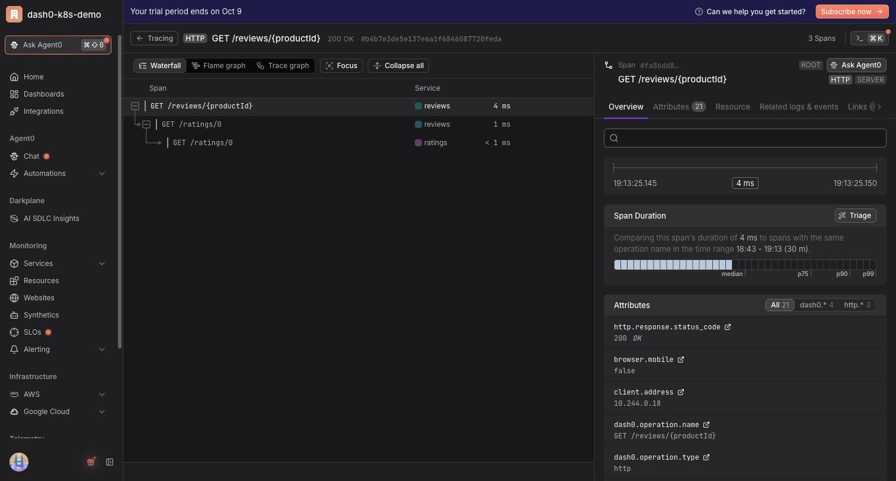
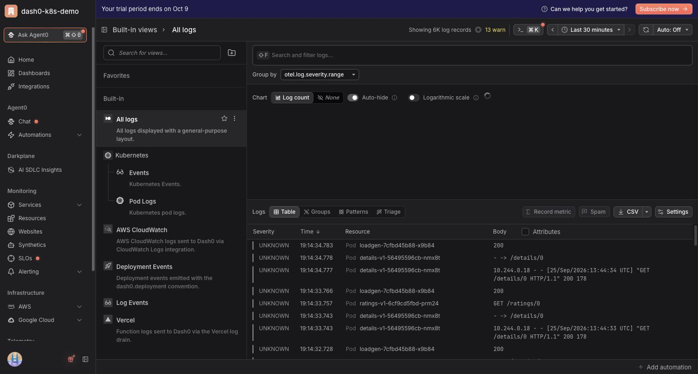
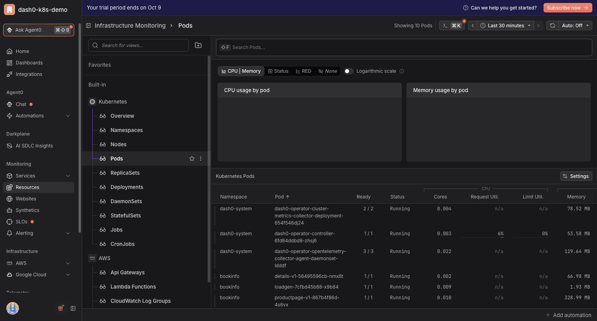

# Zero to Full-Stack Observability on Kubernetes in 20 Minutes

Dash0 operator + Istio Bookinfo (Python, Ruby, Java, Node.js) on kind.

**Needs:** Docker, `kind`, `kubectl`, `helm`, and a [Dash0](https://app.dash0.com) account (free — created in step 3).

**Docker resources:** allocate **4 CPUs / 4 GiB** (Docker Desktop → Settings → Resources).
3 CPUs / 3 GiB is the floor. Below that, etcd becomes I/O-starved, `kube-controller-manager`
loses its leader-election lease and crash-loops, and because nothing creates ReplicaSets the
Deployments stay at `0/0` with no pods at all.

Measured on a 4 CPU / 4 GiB allocation with the app running (two `reviews` versions): **~1.4 GiB of 3.8 GiB used** —
~480 MiB control plane (apiserver alone is ~240 MiB), ~420 MiB app, rest kubelet/containerd.
The Dash0 operator and collector add a few hundred MiB on top, so ~1.7 GiB total.

## 1. Cluster

```bash
kind create cluster --config kind-config.yaml
```

`kind-config.yaml` disables leader election (pointless on a single control-plane node, and the
thing that crash-loops when the node is slow) and reserves CPU/memory for the kubelet so app
pods can never starve the control plane.

## 2. Deploy app

```bash
kubectl apply -k app/
kubectl -n bookinfo wait --for=condition=available deploy --all --timeout=5m
kubectl -n bookinfo port-forward svc/productpage 9080:9080   # localhost:9080/productpage
```



## 3. Sign up to Dash0 and get your credentials

1. Go to [app.dash0.com](https://app.dash0.com) and sign up (free trial, no credit card).
   Sign in with Google/GitHub/email and create an organization when prompted.
2. In Dash0, open **Organization Settings → Endpoints** and copy:
   - the **OTLP gRPC** endpoint — e.g. `ingress.us-west-2.aws.dash0.com:4317` → `DASH0_ENDPOINT`
   - the **API** endpoint — e.g. `https://api.us-west-2.aws.dash0.com` → `DASH0_API_ENDPOINT`
3. Open **Organization Settings → Auth Tokens**, click **Create token**, give it a name
   (e.g. `k8s-demo`) and copy the generated token → `DASH0_AUTH_TOKEN`.
   The token is shown once — copy it before closing the dialog.

Put them in a `.env` file:

```bash
cp .env.example .env
```

```bash
# .env
DASH0_ENDPOINT=ingress.us-west-2.aws.dash0.com:4317
DASH0_API_ENDPOINT=https://api.us-west-2.aws.dash0.com
DASH0_AUTH_TOKEN=auth_xxxxxxxxxxxxxxxxxxxxxxxxxxxxxxxx
```

Pick the endpoints for **your** region — they differ per organization, so copy them from the
Dash0 UI rather than using the values above verbatim. `.env` is gitignored; never commit the token.

## 4. Source the .env file

The Helm command in the next step reads these as shell variables, so export them into your
current shell:

```bash
set -a; source .env; set +a
```

Verify they are set before continuing — if any is empty, the operator installs without a
working export and no data reaches Dash0:

```bash
echo "$DASH0_ENDPOINT" "$DASH0_API_ENDPOINT" "${DASH0_AUTH_TOKEN:0:8}..."
```

Run this in the same terminal you use for the next step (a new terminal needs `source .env` again).

## 5. Install operator

```bash
helm repo add dash0-operator https://dash0hq.github.io/dash0-operator && helm repo update dash0-operator
helm install --wait --namespace dash0-system --create-namespace \
  --set operator.dash0Export.enabled=true \
  --set operator.dash0Export.endpoint=$DASH0_ENDPOINT \
  --set operator.dash0Export.apiEndpoint=$DASH0_API_ENDPOINT \
  --set operator.dash0Export.token=$DASH0_AUTH_TOKEN \
  --set operator.clusterName=dash0-demo \
  --set operator.instrumentation.enablePythonAutoInstrumentation=true \
  --set operator.instrumentation.enableRubyAutoInstrumentation=true \
  dash0-operator dash0-operator/dash0-operator
```

## 6. Enable monitoring

```bash
kubectl apply -n bookinfo -f dash0/dash0-monitoring.yaml
kubectl -n bookinfo get pods -w
```

## 7. Dash0

Everything below lives in the left sidebar, which is grouped into sections. Two of them matter:

| Section | Items | What you use it for |
|---|---|---|
| **Monitoring** | **Services** (expand → Catalog, Map), **Resources** | Service health, dependency map, Kubernetes objects |
| **Telemetry** | **Logs**, **Tracing** | Raw log lines and individual traces |

**Telemetry is below Infrastructure — you have to scroll the sidebar down to see it.** That is the
single most common "I can't find Tracing" moment.

Also note the **time range picker** in the top right (defaults to `Last 30 minutes`). If a screen
looks empty, it is almost always the time range, not missing data.

**Services → Catalog**


**Services → Map**


**Tracing**


**Logging**


**Resources → Pods**


## 8. Break it and debug it

This is the payoff for the hook: the exact "broken for some users, fine for others" failure.

### Break it

```bash
kubectl -n bookinfo scale deploy ratings-v1 --replicas=0
```

`ratings-v1` is the only ratings Deployment, so its Service now has zero endpoints and every
call to `http://ratings:9080` gets **connection refused**.

### Show that kubectl tells you nothing

```bash
kubectl -n bookinfo get pods
```

Every remaining pod is `Running` and `1/1`. Nothing is red, nothing is restarting, and the
pod you would want to read logs from no longer exists. This is the "Kubernetes thinks
everything is fine" moment.

```bash
kubectl -n bookinfo logs deploy/loadgen --tail=10   # all 200s
```

The product page still returns **HTTP 200 on every request**, broken or not. Worth calling out:
an uptime check or an HTTP status dashboard would not catch this at all.

### Show the intermittent symptom

Refresh `localhost:9080/productpage` several times. Roughly half the refreshes show
**"Ratings service is currently unavailable"** in red, the other half look completely normal.

Why: `reviews-v1` and `reviews-v2` both back the `reviews` Service, so the ClusterIP
round-robins between them. **v1 never calls ratings**, so it is unaffected; **v2 does**, so it
degrades. Point at the `Reviews served by: reviews-vN-...` line under each review — it names the
pod that served the request, so the audience can see which version they landed on.

### Debug it in Dash0

Order matters here — lead with the signals that actually move.

1. **Logging** — sidebar → **Telemetry → Logs** (scroll the sidebar down). In the middle panel
   pick **All logs**, or **Kubernetes → Pod Logs** to scope it to pods. Filter to the `reviews`
   service in the **Search and filter logs...** bar for the current window. You get one line per
   failed request, and it names the dependency and the failure mode outright:

   ```
   Error: unable to contact http://ratings:9080/ratings got exception
   javax.ws.rs.ProcessingException: java.net.ConnectException:
   ConnectException invoking http://ratings:9080/ratings/0: Connection refused
   ```

   Also show that the lines come only from the `reviews-v2` pod, never `reviews-v1`.

2. **Tracing** — sidebar → **Telemetry → Tracing** (same scrolled-down section as Logs). Keep the
   time range tight (`Last 30 minutes` or less) or healthy old traces bury the broken ones. In the
   **Search and filter...** bar, filter on `otel.span.status_code` = `ERROR`, or open the **Triage**
   tab to get failures pre-grouped. Click a trace and stay on the **Waterfall** tab.

   The failed span is the **client span from reviews to ratings** (`GET /ratings/0`, service
   `reviews`); its parent `GET /reviews/{productId}` server span is still **200 OK** in the header,
   which is exactly why the symptom is invisible from the outside. Then open a trace that landed
   on `reviews-v1` and compare: same product page request, no ratings span at all.

3. **Service map** — sidebar → **Services** (click to expand) → **Map**, then **All services** in
   the middle panel. The `reviews → ratings` edge is marked with errors, and `ratings` has no
   healthy inbound traffic.

4. **Resources → Pods** — sidebar → **Resources**, then in the middle panel under
   **Built-in → Kubernetes** click **Pods**. Filter `namespace = bookinfo` in the **Search Pods...**
   bar. The ratings pod is simply absent from the list. Root cause, in one screen.

> Note on error rate: because `reviews` catches the exception and still answers 200, the
> **inbound** error rate for `reviews` may stay flat in the services catalog. The error lives on
> its **outbound** call. Check your own screen during the dry run and say whichever is true —
> "the error rate climbs" if it does, or make the point that it does *not*, which is a stronger
> argument for span-level data anyway.

### Fix it

```bash
kubectl -n bookinfo scale deploy ratings-v1 --replicas=1
kubectl -n bookinfo rollout status deploy/ratings-v1
```

Refresh the product page a few times — stars on every refresh. Back in Dash0, the errored
`reviews → ratings` spans stop and the map edge goes green. Give it 30–60s for the new data to
land before cutting back to the UI.

### Optional second break (cut this first if you are long)

```bash
kubectl -n bookinfo set image deploy/details-v1 details=registry.istio.io/release/examples-bookinfo-details-v1:does-not-exist
```

Shows up as `ImagePullBackOff` in Resources → Pods. Undo with:

```bash
kubectl -n bookinfo rollout undo deploy/details-v1
```

**Dry-run this part before recording** and adjust the Dash0 wording to match what your screen
actually shows.

## 9. Teardown

```bash
kind delete cluster --name dash0-demo
```
